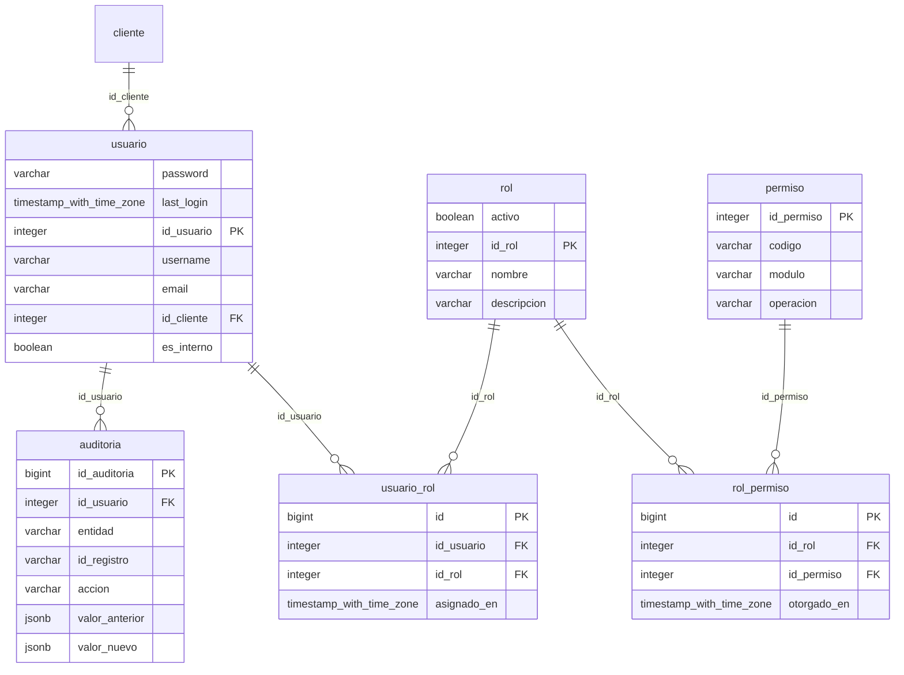
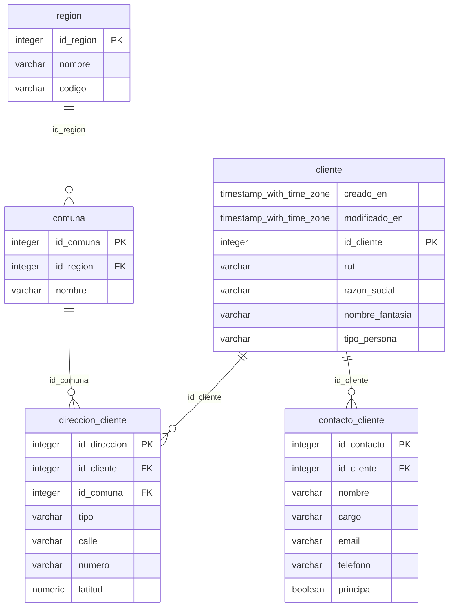
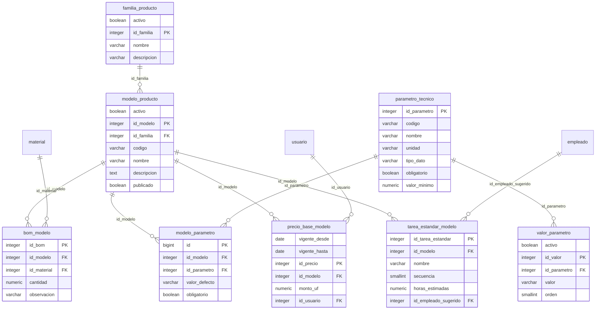
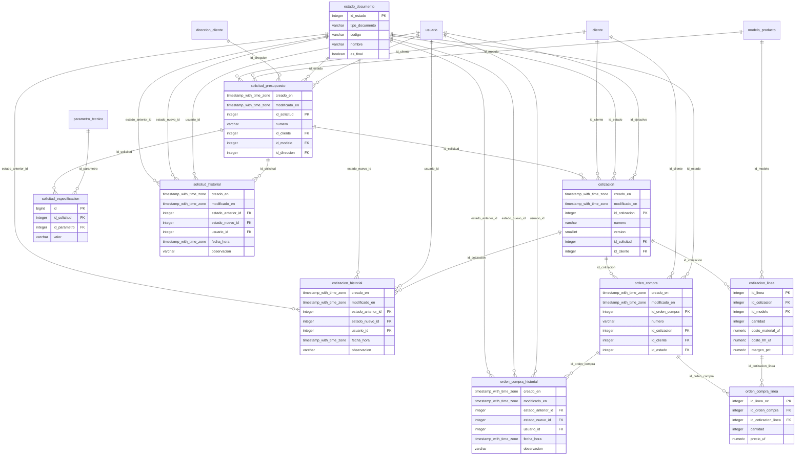
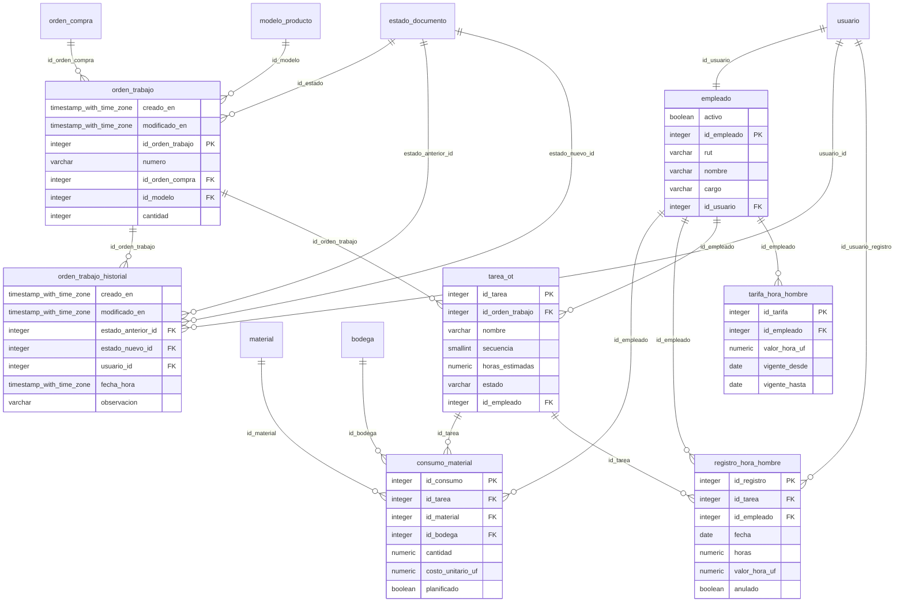
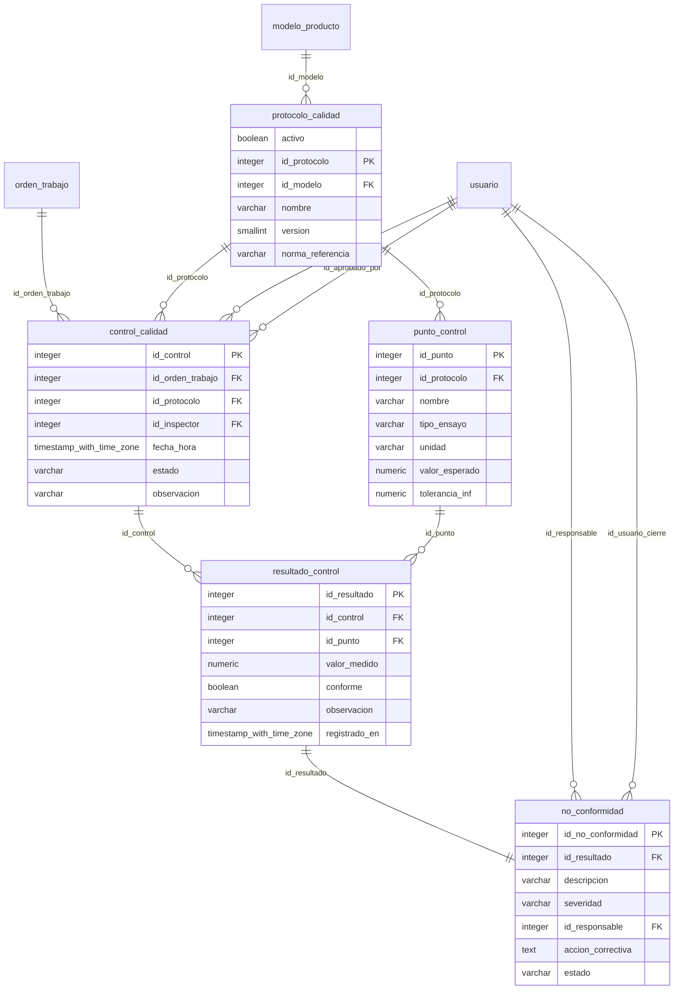
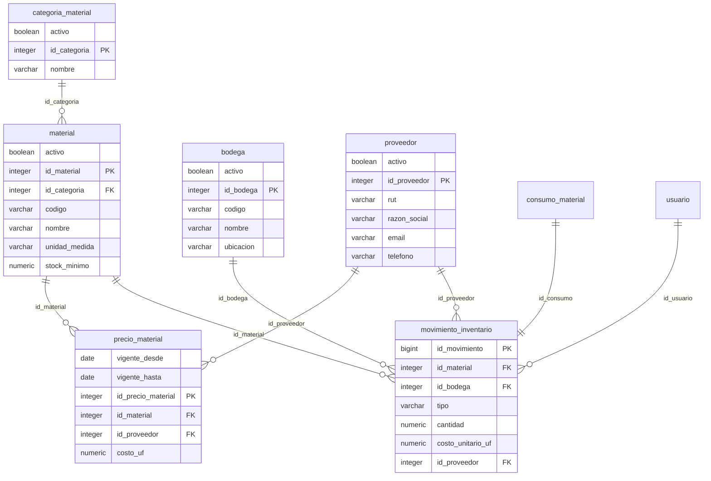
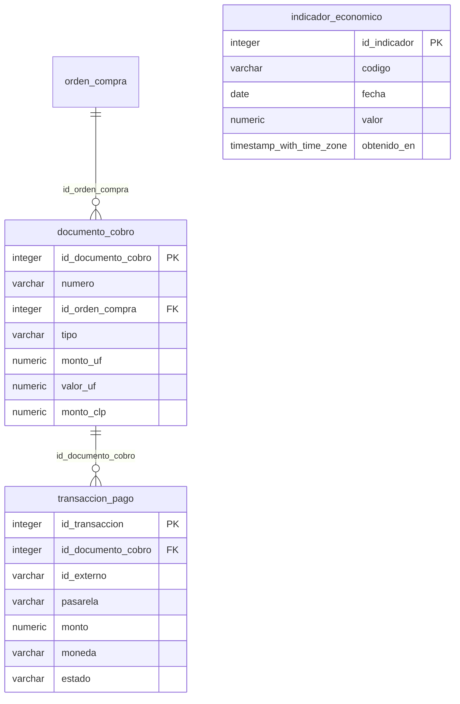
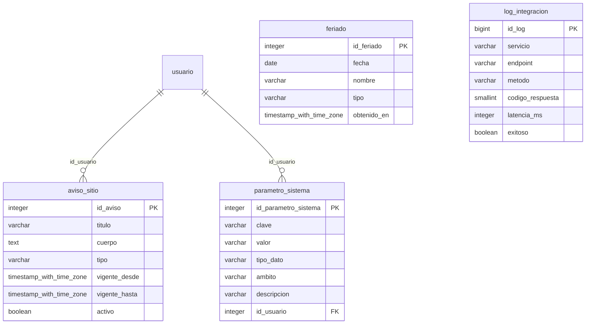

# Base de datos — SITRAFO

Base de datos **relacional PostgreSQL 16**, normalizada en **tercera forma normal (3FN)**, con **54 tablas** del modelo de negocio (requisito minimo: 30). Corresponde al **MER-01 v2.1** y al codigo actual del repositorio (todas las migraciones aplicadas).

| Archivo | Contenido |
|---|---|
| `esquema_sitrafo.sql` | Script DDL: tablas, claves primarias y foraneas, indices y restricciones. |
| `datos_demo.sql` | Datos de demostracion: catalogo, cliente, dos pedidos completos (ver abajo), inventario, calidad, cobros, indicadores y feriados. |
| `diccionario_datos.md` | Cada tabla con sus columnas, tipos, claves, restricciones y descripcion. |
| `README.md` | Este documento: composicion, normalizacion, diagramas entidad-relacion, datos y restauracion. |

## Composicion

| Modulo | Tablas |
|---|---|
| Seguridad y auditoria | 6 |
| Clientes | 5 |
| Catalogo y recetas | 8 |
| Proceso comercial | 10 |
| Produccion | 7 |
| Control de calidad | 5 |
| Inventario | 6 |
| Cobros, pagos e indicadores | 3 |
| Configuracion e integraciones | 4 |
| **Total modelo de negocio** | **54** |

El esquema incluye ademas 9 tablas tecnicas del framework (sesiones, tipos de contenido, migraciones, permisos internos de Django y revocacion de tokens JWT), que no forman parte del modelo de negocio y no se contabilizan.

## Normalizacion

- **1FN:** todos los atributos son atomicos; los valores multiples (parametros tecnicos de un modelo, lineas de una cotizacion, tareas de una orden) estan en tablas propias.
- **2FN:** cada tabla tiene clave primaria simple (`id_...`); ningun atributo depende de una parte de una clave compuesta. Las relaciones muchos a muchos se resuelven con tablas intermedias con clave propia y restriccion unica: `usuario_rol`, `rol_permiso`, `modelo_parametro`, `bom_modelo`.
- **3FN:** no hay dependencias transitivas. Los datos de referencia viven en su tabla y se referencian por clave foranea: `region`/`comuna`, `familia_producto`, `estado_documento`, `categoria_material`, `parametro_tecnico`/`valor_parametro`.
- **Historial separado:** cada documento del flujo tiene su tabla de historial de estados (`solicitud_historial`, `cotizacion_historial`, `orden_compra_historial`, `orden_trabajo_historial`).
- **Valores versionados por vigencia:** precios de modelos (`precio_base_modelo`), precios de materiales (`precio_material`) y tarifas de hora hombre (`tarifa_hora_hombre`) con vigencia desde y hasta: los documentos historicos conservan el valor que regia.
- **Sin datos derivados almacenados en duplicado:** el stock se calcula desde `movimiento_inventario`; la UF y el monto en pesos se congelan en cada documento (RN-03) por requerimiento de negocio, no por duplicacion.
- **Parametros de negocio en tabla:** anticipo, umbrales de descuento y de desviacion, vigencia, tope de unidades y horas diarias viven en `parametro_sistema` con su rango permitido, y se editan sin redesplegar.
- **Integridad declarada en la base:** claves foraneas en todas las relaciones (el borrado de registros referenciados lo impide ademas la aplicacion, para no perder historia), restricciones `UNIQUE` (RUT, numeros de documento, codigos) y `CHECK` (por ejemplo, horas y cantidades positivas).

## Diagramas entidad-relacion por modulo

GitHub dibuja estos diagramas automaticamente. Se muestran hasta siete columnas por tabla; el detalle completo esta en `diccionario_datos.md`. Las tablas sin columnas pertenecen a otro modulo y aparecen solo para mostrar la relacion.

### Seguridad y auditoria

Relacionado con: `cliente`.



### Clientes



### Catalogo y recetas

Relacionado con: `empleado`, `material`, `usuario`.



### Proceso comercial

Relacionado con: `cliente`, `direccion_cliente`, `modelo_producto`, `parametro_tecnico`, `usuario`.



### Produccion

Relacionado con: `bodega`, `estado_documento`, `material`, `modelo_producto`, `orden_compra`, `usuario`.



### Control de calidad

Relacionado con: `modelo_producto`, `orden_trabajo`, `usuario`.



### Inventario

Relacionado con: `consumo_material`, `usuario`.



### Cobros, pagos e indicadores

Relacionado con: `orden_compra`.



### Configuracion e integraciones

Relacionado con: `usuario`.



## Datos de demostracion

`datos_demo.sql` se genero con los comandos de carga del sistema (`cargar_estados`, `cargar_parametros`, `cargar_roles --usuarios-demo`, `cargar_demo` y `cargar_demo_produccion`) y luego recorriendo el proceso con los mismos servicios y la misma API que usan la web y la aplicacion de escritorio. Contiene:

- **OC-2026-0001**, ciclo completo: anticipo pagado, orden de trabajo con horas y consumo de materiales, control de calidad con una no conformidad (corriente de vacio fuera de rango) cerrada con accion correctiva y ensayo repetido, aprobacion del inspector (orden liberada), cierre con desviacion justificada (RN-11), saldo emitido y pagado, y entrega registrada.
- **OC-2026-0002**, en produccion: solicitud desde el portal, cotizacion con 12 % de descuento que supero el umbral y fue aprobada y emitida por otro ejecutivo (RN-05), aceptacion del cliente, anticipo pagado y orden de trabajo generada e iniciada.
- **SP-2026-0002** recibida y **COT-2026-0001** emitida, pendientes de atender.
- Recepcion de compra en bodega, un aviso del sitio y el contacto principal del cliente.
- **Indicadores** UF, dolar observado y UTM con los valores publicados por mindicador.cl al 10-10-2026, y **feriados** legales de Chile 2026. En el sistema desplegado ambos los obtiene la tarea diaria; aqui se cargaron con esos valores porque el entorno de generacion no tenia acceso a esos servicios.

Filas por tabla en los datos de demostracion:

| Tabla | Filas | Tabla | Filas | Tabla | Filas |
|---|---:|---|---:|---|---:|
| `auditoria` | 6 | `aviso_sitio` | 1 | `bodega` | 1 |
| `bom_modelo` | 24 | `categoria_material` | 5 | `cliente` | 1 |
| `comuna` | 346 | `consumo_material` | 6 | `contacto_cliente` | 1 |
| `control_calidad` | 1 | `cotizacion` | 3 | `cotizacion_historial` | 7 |
| `cotizacion_linea` | 3 | `direccion_cliente` | 1 | `documento_cobro` | 3 |
| `empleado` | 3 | `estado_documento` | 22 | `familia_producto` | 2 |
| `feriado` | 16 | `indicador_economico` | 3 | `log_integracion` | 0 |
| `material` | 6 | `modelo_parametro` | 20 | `modelo_producto` | 4 |
| `movimiento_inventario` | 13 | `no_conformidad` | 1 | `orden_compra` | 2 |
| `orden_compra_historial` | 4 | `orden_compra_linea` | 2 | `orden_trabajo` | 2 |
| `orden_trabajo_historial` | 7 | `parametro_sistema` | 15 | `parametro_tecnico` | 5 |
| `permiso` | 93 | `precio_base_modelo` | 3 | `precio_material` | 6 |
| `protocolo_calidad` | 4 | `proveedor` | 2 | `punto_control` | 32 |
| `region` | 16 | `registro_hora_hombre` | 6 | `resultado_control` | 9 |
| `rol` | 6 | `rol_permiso` | 140 | `solicitud_especificacion` | 9 |
| `solicitud_historial` | 4 | `solicitud_presupuesto` | 3 | `tarea_estandar_modelo` | 20 |
| `tarea_ot` | 10 | `tarifa_hora_hombre` | 3 | `transaccion_pago` | 3 |
| `usuario` | 9 | `usuario_rol` | 7 | `valor_parametro` | 10 |

Consideraciones de privacidad y honestidad de los datos:

- No contiene informacion personal: el cliente, sus contactos y los empleados son ficticios, y los correos usan dominios de demostracion.
- **Todas las cuentas tienen la clave deshabilitada** (no se publica ningun hash de contrasena). Despues de restaurar, asigne claves con `python manage.py changepassword <usuario>` o vuelva a ejecutar `cargar_roles --usuarios-demo`.
- **Los pagos son simulados:** se registraron con el doble de prueba de PayPal que usan las pruebas automatizadas, por lo que sus identificadores llevan el prefijo `DEMO-SIM`. No corresponden a transacciones del sandbox de PayPal. Por lo mismo, `log_integracion` va vacia: no se publican como reales llamadas externas que no ocurrieron.
- Se omitieron sesiones, tokens JWT y el historial del administrador de Django.

## Restaurar la base

Con PostgreSQL 16 y una base vacia:

```bash
psql -U <usuario> -d <base> -f esquema_sitrafo.sql
psql -U <usuario> -d <base> -f datos_demo.sql
```

Se verifico restaurando ambos archivos en una base vacia: cargan sin errores, con las mismas filas que la base de origen, y `python manage.py migrate --check` confirma que no quedan migraciones pendientes.

Con el proyecto en Docker, la forma recomendada es crear el esquema con las migraciones del sistema, que generan exactamente este mismo DDL:

```bash
docker compose exec web python manage.py migrate
```
